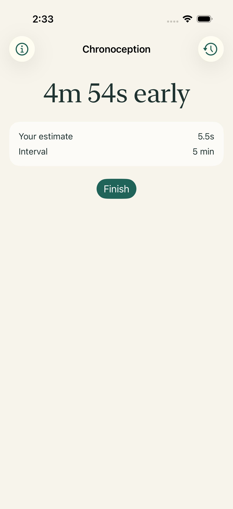
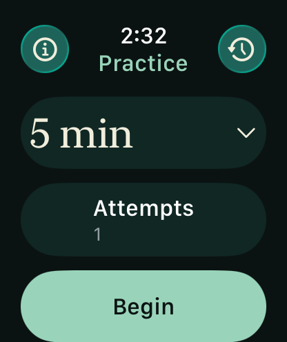

# Chronoception native acceptance

Head: `1c1948eb546bf874608cef76dcd6825bedd28bef`. Tested PR merge: `9fc37f45b56fd33df6ae538c9c8585506d712b6b`.

[All four checks passed](https://github.com/kubla/chronoception/actions/runs/41758706725): core, unsigned release archive, iPhone and Watch acceptance. Five native journeys passed per platform. Each receipt requires nine named screenshots, five app recordings and launch observations; no evidence is missing. Launch observations include automation overhead.

 

The rendered title contrast check measured 19.22:1 on iPhone and 11.18:1 on Watch. It is a focused regression check, not full accessibility certification. Core evidence includes two compiling faults rejected and a bounded lifecycle model with 16 distinct states. It is not a proof of the whole application.

This evidence branch preserves captures and receipts without adding review media to the app candidate. Full recordings and captures were downloaded to local review storage; CI artifacts expire after seven days. Signing, physical haptics and store distribution were not run. Personal Apple Developer enrollment remains necessary for TestFlight commissioning.
