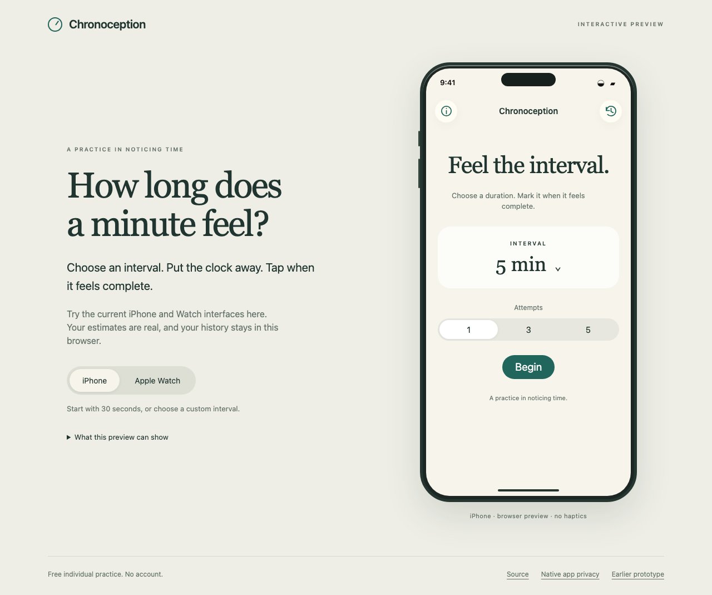
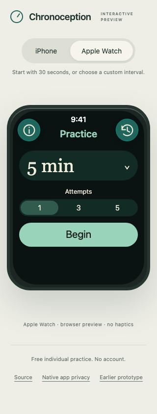

# Browser preview evidence

Candidate head `f968faa29939074d186c44ded59de924d71d67d5`, tested PR merge `465745f457159d96c2a0944d9ecfc3f9913ae253`.

[CI run](https://github.com/kubla/chronoception/actions/runs/41766217342) verifies strict TypeScript, current generated modules and content-based asset URLs, twelve state-model tests, five real-browser journeys and six viewport/device combinations. The receipt reports no page errors or failed resources. The cloud recording decodes as VP9, 1280 × 960, 6.08 seconds. Complete media is in the CI core artifact and was downloaded locally.

The screenshots here come from clean Chromium exercising the actual Pages files on an isolated CI server. The public Pages deployment was separately opened and exercised in Chrome, including mobile widths. Browser evidence does not establish native haptics or locked-device behavior.

