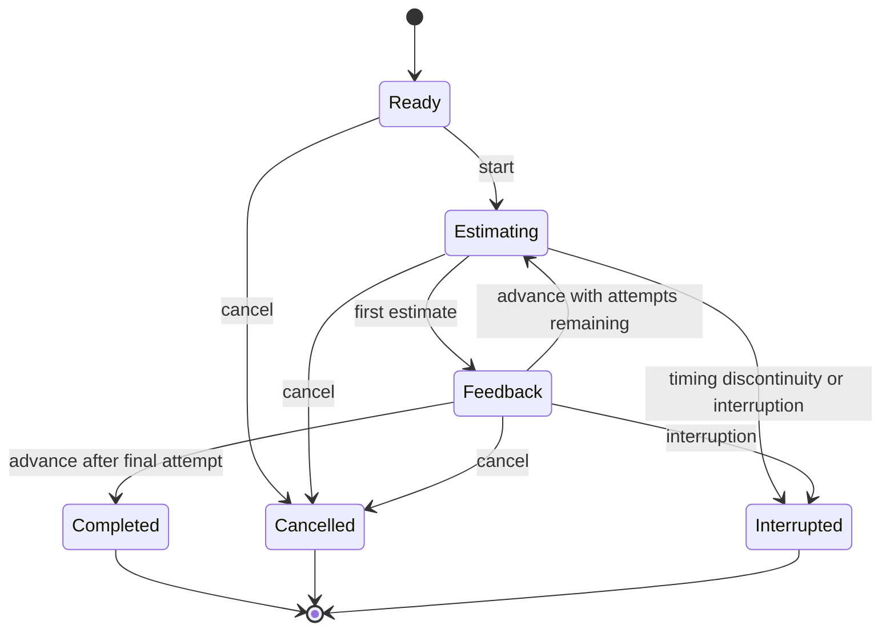

# Practice-session state

`SessionEngine` implements these transitions. Its time inputs are explicit Swift durations. The application measures them with ContinuousClock, which advances during sleep; saved history stores observations rather than process-specific instants. On a new launch, persisted active records become interrupted.

An attempt resolves once. Terminal sessions remain terminal. Completed attempts survive cancellation or interruption. Feedback advances only through a separate deliberate action. Tests exercise the production engine, including generated event sequences and seeded faults.
