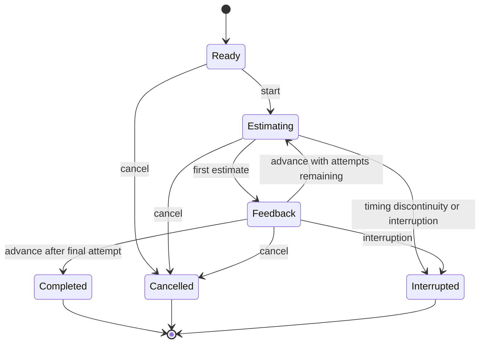
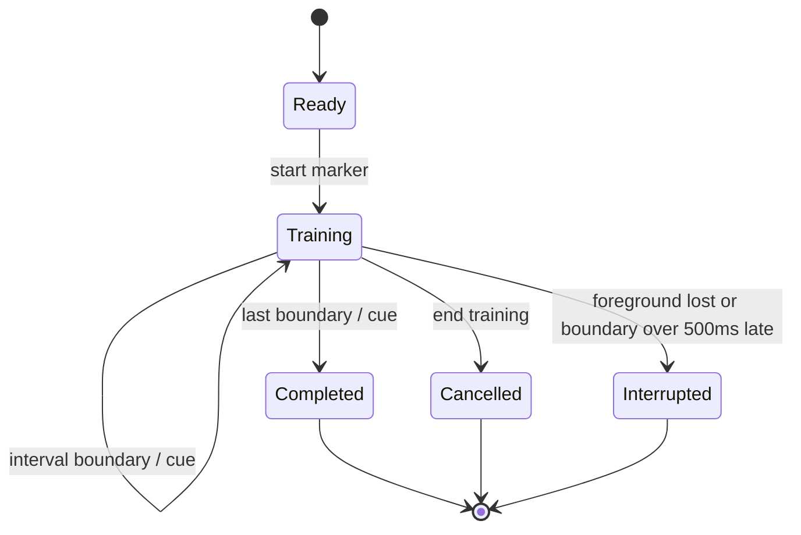

# Practice-session state

`SessionEngine` implements these transitions. Its time inputs are explicit Swift durations. The application measures them with ContinuousClock, which advances during sleep; saved history stores observations rather than process-specific instants. On a new launch, persisted active records become interrupted.

An attempt resolves once. Terminal sessions remain terminal. Completed attempts survive cancellation or interruption. Feedback advances only through a separate deliberate action. Tests exercise the production engine, including generated event sequences and seeded faults.

## Training state

`TrainingEngine` accepts explicit monotonic time. Each accepted boundary adds exactly one cued interval; duplicate pulses do not add cues. A delayed boundary interrupts without catch-up. Cancellation and interruption retain only accepted boundaries. The platform adapter requests the cue and retains the count; neither that count nor a Simulator recording proves that a person felt a haptic.

Training records and estimates remain separate, including after persistence/relaunch. Old estimation-only history loads without migration loss. Calibration compares estimates for the same duration, newest first, in windows of up to five observations with explicit sample counts.
